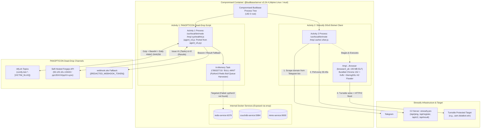
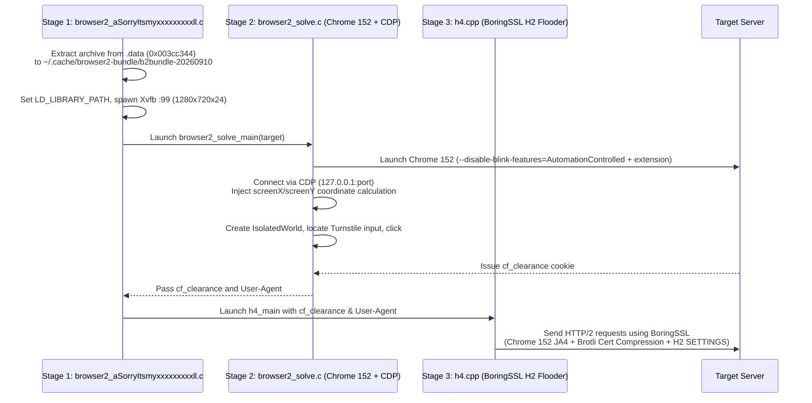

## TL;DR

During an investigation into a self-hosted compromised Budibase container, I pulled core dumps from two suspicious processes sharing a parent process tree. Inside, I found two completely separate threat actors operating side by side:

* **Actor 1 (PANOPTICON):** A dead-drop Node.js implant running out of `/tmp/.syshealthd.js`. It pulled commands from `ntfy.sh` topics and self-hosted Forgejo repository issues, authenticating tasks with daily HMAC-SHA256 keys. It tried to capture internal Redis Bull queues, but failed because the Alpine container had no Python runtime.
* **Actor 2 (Stressify Botnet):** A commercial DDoS worker that resolved its active C2 address by parsing a public Telegram account bio. It deployed a 193 MB custom ELF binary (`browser2_all`) containing headless Chromium, an Xvfb virtual frame buffer, and a BoringSSL HTTP/2 flooder built to bypass Cloudflare Turnstile challenges.
* **Forensic Reality:** With minimal tools installed and disk state wiped, traditional filesystem triage came up empty. Process memory dumps (`gcore`) recovered the full unminified JavaScript source, active C2 infrastructure, and every production credential leaked through container environment variables. I packaged and open-sourced the custom Python scripts built for this analysis in [`eln1x/node-memory-forensics-toolkit`](https://github.com/eln1x/node-memory-forensics-toolkit).

---

## What Happened

Minimal Alpine containers feel safe right up until they aren't. Strip out the package manager, drop Python, pull `curl`, kill systemd. None of it matters if the app running inside still holds the keys to your infrastructure. When attackers get remote code execution, they don't pack up because there's no bash prompt. They just adapt to the runtime .

During an incident investigation on a **Budibase (`@budibase/server` v3.24.4)** container (`HOSTNAME=[REDACTED_CONTAINER_NAME]`, Alpine Linux, Node.js `v22.22.0`), I pulled process memory dumps expecting to find a single intruder. Instead, I found two completely unrelated post-exploitation operations living together inside the same container:

1. **A dead-drop C2 implant (`PANOPTICON` / `agent_v5.js`)**: A Node.js implant dropped at `/tmp/.syshealthd.js`. Its own code comments noted it was ported straight from Python so it could run in containers without a Python runtime. It ran tasks through public `ntfy.sh` topics, self-hosted **Forgejo issue comments**, and `webhook.site`, authenticating everything with daily-rotating HMAC-SHA256 signatures while trying to drain internal **Redis Bull queues**.
2. **A heavy DDoS botnet worker (`stressify.pro` + `browser2_all`)**: A lightweight Node.js bot (`/tmp/.cache/.x/bot.js`) that pulled its active C2 domain out of a **Telegram**. Staged next to it sat a massive **193 MB ELF binary (`browser2_all`)** bundling headless Chromium 152, an in-memory `Xvfb` display, and an HTTP/2 flooder (`h4`) compiled with BoringSSL to clone Chrome's exact TLS and HTTP/2 handshake fingerprints.

Both processes branched off the same parent process tree, pointing to a single initial entry point, likely an RCE or leaked admin credentials on the Budibase instance. Once inside, they operated in total isolation. Neither knew the other was there.

---

## Big-Picture Incident Architecture



---

## Part 1: Container Triage & The Leaked Environment

Attackers may delete staging files, but data they loaded into a running V8 process can sometimes remain recoverable from heap or stack memory (if memory is captured before it is overwritten, reclaimed, or the process exits).

Because disk state in containers is transient, I pulled full core dumps of both running processes (`memdump_syshealth` and `memdump_bot`) and built [`node-memory-forensics-toolkit`](https://github.com/eln1x/node-memory-forensics-toolkit) to parse the raw ELF64 segments and V8 heap structures directly. Running [`inspect_elf_core.py`](https://github.com/eln1x/node-memory-forensics-toolkit/blob/master/scripts/inspect_elf_core.py) against the standard ELF notes (`NT_PRPSINFO`, `NT_PRSTATUS`, `NT_FILE`) confirmed both processes pointed back to a common parent and verified they were running against musl (`/lib/ld-musl-x86_64.so.1`), the lightweight container alternative to glibc.

Then came the stack memory (`envp`). Because Docker drops container environment variables directly into the init process stack, every child process down the tree inherited the full set of production secrets:

| Environment Variable | Value / Identifier | Scope |
| :--- | :--- | :--- |
| `SERVICE` / `DD_VERSION` | `app-service` (`@budibase/server` `v3.24.4`) | App version |
| `BB_ADMIN_USER_EMAIL` / `PASSWORD` | `[REDACTED_ADMIN_EMAIL]` / `[REDACTED_PASSWORD]` | Budibase administrative account |
| `JWT_SECRET` / `API_ENCRYPTION_KEY` | `[REDACTED_JWT_SECRET]` | Session tokens & data encryption |
| `REDIS_URL` / `REDIS_PASSWORD` | `redis-service:6379` / `[REDACTED_REDIS_PW]` | Redis service credentials |
| `COUCH_DB_URL` | `http://[REDACTED_DB_CREDENTIALS]@couchdb-service:5984` | Primary database credentials |
| `MINIO_URL` / `MINIO_SECRET_KEY` | `http://minio-service:9000` / `[REDACTED_MINIO_PW]` | S3-compatible object store |


---

## Part 2: First Activity: The PANOPTICON Dead-Drop Implant

### 1. Script Configuration and Execution Context
In `memdump_syshealth`, the `NT_PRPSINFO` note showed the command line: `/usr/local/bin/node /tmp/.syshealthd.js`. Because Node keeps source strings around in V8 heap space, carving memory starting at virtual address `0x2c46324054d8` with [`extract_v8_script.py`](https://github.com/eln1x/node-memory-forensics-toolkit/blob/master/scripts/extract_v8_script.py) handed me the complete, unminified script, complete with its original docstring:

```javascript
#!/usr/bin/env node
/**
 * agent_v5.js: Node.js port of agent_v5.py (PANOPTICON dead-drop agent).
 * For Budibase/Node containers that lack python3.
 * Pure Node stdlib: https, http, zlib, crypto, child_process, fs, os.
 *
 * Channels:
 *   1. ntfy.sh (subscribe task topic, publish beacon + results)
 *   2. Forgejo issue comments (poll issue #1 for tasks, post beacon/results to #1/#2)
 *   3. webhook.site (one-way beacon + result fallback)
 */
```

The author knew their target environment well enough to realize Python was missing, so they rewrote their agent in pure Node standard libraries (`https`, `http`, `zlib`, `crypto`, `child_process`, `fs`, `os`). No `node_modules` required.

Dumping stack memory at `0x7fff03c22f19` gave me the runtime configuration passed into the process at startup:

* `IMPLANT_AGENT_ID=[VICTIM_IDENTIFIER]`
* `TASK_HMAC_KEY=c0mfy-b0tn3t-2026-k3y`
* `FJO_REPO=pp135XXX/ppXX-sync` *(overrode hardcoded fallback `kz453XXX/config-sync`)*
* `FJO_TOKEN=[REDACTED_FJO_TOKEN]` *(overrode fallback `[REDACTED_FALLBACK_TOKEN]`)*
* `WH_TOKEN=[REDACTED_WEBHOOK_TOKEN]`

### 2. Tri-Channel Dead-Drop C2 and Authentication
Rather than establishing a direct socket back to a suspicious IP, `agent_v5.js` hid behind three legitimate third-party services: **ntfy.sh**, **Webhook.site**, and a self-hosted **Forgejo** instance (`https://93.125.18.x:19443/api/v1`).

Anyone can listen in on a public `ntfy.sh` topic (`comfy-bot-task-[VICTIM_SLUG]`), so the actor built an HMAC verification scheme to prevent anyone else from hijacking their implants. Tasks were only accepted if signed by a daily-derived key:

$$\text{daily\_key}(\Delta d) = \text{SHA256}\big(\text{TASK\_HMAC\_KEY} \;\|\; \text{UTC\_YYYYMMDD}(t + \Delta d)\big)$$

$$\text{envelope} = \text{Base64}\big(\text{Gzip}_9(\text{JSON})\big) \;\|\; \text{":"} \;\|\; \text{HMAC-SHA256}\big(\text{daily\_key}(0), \text{b64}\big)$$

```javascript
function dailyKey(offsetDays = 0) {
  const d = new Date(Date.now() + offsetDays * 86400000);
  const y = d.getUTCFullYear();
  const m = String(d.getUTCMonth() + 1).padStart(2, "0");
  const day = String(d.getUTCDate()).padStart(2, "0");
  const dayStr = `${y}${m}${day}`;
  return crypto.createHash("sha256").update(Buffer.concat([KEY, Buffer.from(dayStr)])).digest();
}

function unpack(msg) {
  // ...
  for (const k of [dailyKey(0), dailyKey(-1), dailyKey(1), KEY]) {
    const exp = crypto.createHmac("sha256", k).update(b64).digest("hex");
    if (exp.length === sig.length && crypto.timingSafeEqual(Buffer.from(exp), Buffer.from(sig))) {
      const raw = zlib.gunzipSync(Buffer.from(b64, "base64"));
      return JSON.parse(raw.toString("utf-8"));
    }
  }
}
```

Every 20 seconds, the agent polled `ntfy.sh` and Forgejo Issue `#1` (grepping for `<!--task--> <payload>` markers in issue comments). Once verified, tasks were executed via `execSync` or local file reads in 2,500-byte chunks, with outputs posted to `ntfy.sh`, Forgejo Issue `#2` (`<!--result-->`), and Webhook.site.

### 3. The Bull Queue Task and The Python Blunder
Inside the heap, I found the `OrderedHashSet` backing `const seen = new Set()` at `0x17cf380e72e0` by walking V8 tagged pointers with [`extract_v8_set.py`](https://github.com/eln1x/node-memory-forensics-toolkit/blob/master/scripts/extract_v8_set.py). Carving and verifying the gzipped buffers associated with those set entries via [`decode_c2_envelopes.py`](https://github.com/eln1x/node-memory-forensics-toolkit/blob/master/scripts/decode_c2_envelopes.py) let me pull the exact payload the attacker sent.

At address `0x3e979412ecd0`, I found an envelope (`ntfy.sh` message ID `[REDACTED_MSG_ID]`, signed with `dailyKey("2026MMDD")`) carrying `Task ID 1789XXXXXX` from `2026-MM-DD ~HH:MM UTC`:

```bash
echo '=== BULL-MINT ==='; python3 -c '
import os, socket
pw = os.environ.get("REDIS_PASSWORD","")
s = socket.create_connection(("redis-service", 6379), timeout=5)
# ... [raw Redis RESP protocol client] ...
print("AUTH:", cmd("AUTH", pw)[:80])
# Check bull queue job contents
for q in ["auditLogQueue","systemEventQueue","automationQueue","appMigration","appBackupQueue"]:
    for sub in ["completed","wait","active","failed","delayed"]:
        r = cmd("LRANGE", f"bull:{q}:{sub}", "0", "-1")
        if r and not r.startswith("*0"):
            print(f"=== {q}:{sub} ===")
            print(r[:1500])
' 2>&1 | head -800
```

Here's the irony. The threat actor spent real time porting their agent from Python to Node.js specifically because the target container didn't have Python installed. Then, when it came time to actually run post-exploitation tasks, whoever sat at the keyboard dispatched an inline `python3 -c` script to harvest Redis job queues.

The result? The command crashed on launch with `python3: not found`. All that careful implant engineering was undone by an operator following an unadapted playbook.

### 4. Active Campaign, Post-Operation Infrastructure Teardown, and the Ghost Regex
Correlating in-memory HTTP response buffers, network captures (`c2_investigation.pcap`), and V8 JIT code pages (`0x556ad8240000` to `0x556ad82fffff`) uncovered the true operational lifecycle:

* **Deliberate Infrastructure Teardown**: Immediately after the final Redis harvesting task (`1789XXXXXX`) at `2026-MM-DDD ~HH:MM UTC`, the operator dismantled their setup. They deleted user `pp135XXX` on their Forgejo host (`93.125.18.x:19443`) and powered down their backup server (`95.216.249.x:9002`). That caused Forgejo to respond with HTTP 401 Unauthorized (`{"message":"user does not exist [uid: 0, name: ]"}`).

---

## Part 3: Second Activity: The Stressify.pro DDoS Bot

A second Node process was quietly running `/usr/local/bin/node /tmp/.cache/.x/bot.js`.

### 1. Process Startup and the OpenRC Blindspot
I pulled the complete bot source (offsets `0x75f058` to `0x769e90`) and its Russian-language stdout buffer (`0x24930d40`) directly from heap pages using [`extract_v8_script.py`](https://github.com/eln1x/node-memory-forensics-toolkit/blob/master/scripts/extract_v8_script.py) and [`extract_console_logs.py`](https://github.com/eln1x/node-memory-forensics-toolkit/blob/master/scripts/extract_console_logs.py):

```text
[+] Папка скрипта: /tmp/.cache/.x
[+] Файл ID: /tmp/.cache/.x/bot_id.txt
[+] ✅ ID найден в: /tmp/.cache/.x/bot_id.txt
[+] ID: [REDACTED_BOT_ID]
╔═══════════════════════════════════════╗
║          🤖 C2 БОТ ЗАПУЩЕН          ║
╚═══════════════════════════════════════╝
[+] Платформа: linux
[+] Node.js: v22.22.0
[+] PID: 115
[+] Папка скрипта: /tmp/.cache/.x
[+] Основной цикл запущен...
[+] Получение домена из Telegram...
[+] Домен получен из Telegram: stressify.pro
[+] Используемый домен: stressify.pro
[+] Бот зарегистрирован на stressify.pro
[+] Ожидание 38 с до следующего опроса
```

Two details stand out from this startup log:
* **The bot had survived reboots**: The log entry `[+] ✅ ID найден в: /tmp/.cache/.x/bot_id.txt` proves that the bot identifier (`[REDACTED_BOT_ID]`) was generated during an earlier run and pulled from disk.
* **Another container assumption failed**: In `bot.js`, whenever `process.getuid() === 0`, the script tries to establish persistence by dropping `/etc/systemd/system/c2-bot.service` and running `systemctl enable c2-bot`. But Alpine Linux uses OpenRC. Systemd doesn't exist. Just like PANOPTICON, the bot threw an unhandled error inside a swallowed `catch` block and kept going without persistence.

### 2. Telegram Dead-Drops and The Truncation Bug
To find its C2 server without hardcoding an IP that could get burned, `bot.js` scraped the public web view of a Telegram channel bio (`https://t.me/SorryItsmyxxxxxxxxx`):

```javascript
const match = response.body.match(/<div class="tgme_page_title"><span dir="auto">([^<]+)<\/span><\/div>/);
```

Memory buffer `0x66242b` preserved the raw HTML Telegram returned:

```html
<div class="tgme_page_title"><span dir="auto">stressify.pro</span></div>
<div class="tgme_page_extra">
  @SorryItsmyxxxxxxxxx
</div>
```

With the domain extracted, the bot registered itself at `https://stressify.pro/api/register` with `User-Agent: C2-Bot/1.0`, then dropped into a 30-to-45-second polling loop against `/api/ping` and `/api/c2`. Using [`extract_http_traffic.py`](https://github.com/eln1x/node-memory-forensics-toolkit/blob/master/scripts/extract_http_traffic.py), I counted 749 retained Cloudflare HTTP responses in memory across 51 hours of active runtime (`2026-09-18` to `2026-09-20`).

The bot also shipped with an `upload` command for file exfiltration. But whoever built it left an amateur bug in place:

```javascript
const content = fs.readFileSync(filePath, 'base64');
result.output = JSON.stringify({
    name: filePath.split(/[\\/]/).pop(),
    size: stats.size,
    content: content.substring(0, 1000) + (content.length > 1000 ? '...' : '')
});
```

The author hardcoded a 1,000-character cap on base64 data. Any file larger than ~750 bytes was chopped in half before transmission, rendering whatever they stole completely unrecoverable on the other end.

---

## Part 4: Reverse-Engineering the 193 MB Monolith (`browser2_all`)

Staged under `/tmp`, I found a massive 193 MB binary simply named `browser`.

### 1. Fixing the Truncated ELF Headers
The binary recovered from disk was missing its first `0x20000` bytes (128 KB). That broke standard loader tools, but the ELF64 section header table, symbol table (`.symtab`, 10,959 symbols), and string table (`.strtab`) were intact.

Every section header had an exact `-0x20000` offset (`sh_offset - 0x20000`). Once I adjusted the base offsets in Ghidra, the symbol table resolved cleanly, confirming the monolith had been compiled from three source files: `/root/bypass/browser2_all.c`, `/root/bypass/browser2_solve.c`, and `/root/bypass/h4.cpp`.

### 2. The Cloudflare Turnstile Bypass Pipeline
Modern Cloudflare Turnstile doesn't just check if you solved a challenge: it binds the resulting `cf_clearance` cookie to your client's specific TLS and HTTP/2 characteristics. If a DDoS bot tries to solve Turnstile in Chrome and then replays the cookie using Python `requests` or raw libcurl, Cloudflare drops the traffic immediately.

To beat this, the creators of `browser2_all` built a tight, three-stage execution pipeline:



* **Stage 1: Self-Extraction & Virtual Display (`browser2_all.c`)**:
  The binary unpacks a 188.5 MB embedded payload from `.data` (`0x003cc344`) into `~/.cache/browser2-bundle/b2bundle-20260910/`. It configures `LD_LIBRARY_PATH` for bundled libraries (`libnss3.so`, `libgtk-3.so.0`, `libgbm.so.1`) and spawns a headless X11 display using `Xvfb :99 -screen 0 1280x720x24`.
* **Stage 2: CDP Turnstile Solver (`browser2_solve.c`)**:
  It starts Chromium (`Chrome/152.0.7977.75`) with `--disable-blink-features=AutomationControlled` alongside a custom unpacked extension. It hooks into the browser over Chrome DevTools Protocol (CDP) and injects a monkey-patch to fix mouse coordinates:
  ```javascript
  Object.defineProperty(MouseEvent.prototype, 'screenX', {get:function(){return this.clientX+window.screenX;}});
  Object.defineProperty(MouseEvent.prototype, 'screenY', {get:function(){return this.clientY+window.screenY;}});
  ```
  Synthetic clicks generated through CDP often set `screenX` and `screenY` to 0, which Turnstile flags immediately as bot activity. This override calculates realistic screen coordinates from `clientX`/`clientY`. Once injected, it creates an isolated world, clicks the Turnstile widget, captures the resulting `cf_clearance` cookie, and kills Chromium.
* **Stage 3: The BoringSSL HTTP/2 Flooder (`h4.cpp`)**:
  With `cf_clearance` in hand, `browser2_all` launches `h4_main`. This isn't a browser anymore. It's a multi-threaded C++ flooder statically linked against Google BoringSSL and Brotli. It bombards the target with HTTP/2 requests engineered to mirror Chrome 152 down to the wire:
  * **JA4 Fingerprint**: `t13d1517h2_8daaf6152771_b6f405a00624`
  * **Akamai HTTP/2 Fingerprint**: `1:65536;2:0;4:6291456;6:262144|15663105|3:0:200:0,5:0:100:0,7:0:100:0,9:0:100:0,11:0:100:0|m,a,s,p`

### 3. The Typo That Gave Them Away
For all their effort matching TLS signatures and HTTP/2 parameter tables, they left a glaring typo in `.rodata` (`0x002beb88`) inside `h4.cpp`. Look closely at their hardcoded fallback User-Agent:

```text
Mozilla/5.0 (X11; Linux x86_64) AppleWebKit/537.36 (KHTML, like Gecko) Chrome/152.0.0.0 Safa5 Safari/537.36
```

`Safa5`. A stray keystroke right in the middle of a string designed to stay hidden. That single typo turns an otherwise sophisticated impersonation engine into an immediate, high-confidence detection signature.

---

## Part 5: Side-by-Side Comparison

Putting the two implants side by side highlights how different their operational goals were:

| Dimension | Process 1 (`PANOPTICON`) | Process 2 (`stressify.pro`) |
| :--- | :--- | :--- |
| **Primary Goal** | Command execution & database exfiltration | Turnstile-bypassing DDoS flooder |
| **Payload Delivery** | Pure Node.js script (`/tmp/.syshealthd.js`) | Monolithic 193 MB ELF with Chrome (`/tmp/.../browser`) |
| **C2 Architecture** | Dead drops (`ntfy.sh`, Forgejo API, `webhook.site`) | Telegram bio scraping + REST API (`stressify.pro`) |
| **Authentication** | Rotating daily HMAC-SHA256 signature | Dynamic C2 domain via Telegram; TLS/H2 fingerprint cloning |
| **Targeted Asset** | Internal Redis Bull queues (`auditLogQueue`, etc.) | External web targets |
| **Fatal Assumption** | Tried to invoke `python3` on a minimal container | Tried to install systemd units on an OpenRC system |
| **Interaction** | None. Completely unaware of Process 2 | None. Completely unaware of Process 1 |


---

## Part 6: Indicators of Compromise (IoCs)

### 1. Host & Container Artifacts
| Type | Indicator | Context |
| :--- | :--- | :--- |
| **File Path** | `/tmp/.syshealthd.js` & `/tmp/.syshealthd.log` | `PANOPTICON` (`agent_v5.js`) Node.js script & log |
| **File Path** | `/tmp/.cache/.x/bot.js` | `stressify.pro` Node.js bot |
| **File Path** | `/tmp/.cache/.x/bot_id.txt` & `/tmp/.cache/.x/.bot.pid` | Bot ID (`[REDACTED_BOT_ID]`) & lockfile |
| **File Path** | `/etc/systemd/system/c2-bot.service` | Failed systemd unit drop |
| **File Path** | `~/.cache/browser2-bundle/b2bundle-20260910/` | Extracted Chrome 152 + `Xvfb` runtime files |
| **File Path** | `/tmp/browser2-fonts-*.conf` & `/tmp/chrome-profile-*` | `browser2_all` runtime scratch files |
| **SHA-256** | `ca8009391851e635530202002026d6e78e5fdad47be5ef9345599149db60eccf` | `browser` (`browser2_all`, truncated sample) |

### 2. Network & C2 Indicators
| Activity | Indicator Type | Value |
| :--- | :--- | :--- |
| **PANOPTICON** | `ntfy.sh` Topics (`159.203.148.x`) | `https://ntfy.sh/comfy-bot-beacon-[VICTIM_SLUG]`<br>`https://ntfy.sh/comfy-bot-task-[VICTIM_SLUG]`<br>`https://ntfy.sh/comfy-bot-results-[VICTIM_SLUG]` |
| **PANOPTICON** | Self-Hosted Forgejo C2 | `https://93.125.18.x:19443/api/v1` (Repos: `pp135XXX/ppXX-sync`, `kz453XXX/config-sync`) |
| **PANOPTICON** | Webhook.site Fallback | `https://webhook.site/[REDACTED_WEBHOOK_TOKEN]` |
| **PANOPTICON** | Headers & Key | `User-Agent: dead/5.0`, `X-Bot: [VICTIM_IDENTIFIER]`, Key: `c0mfy-b0tn3t-2026-k3y` |
| **Stressify Bot** | Telegram Dead-Drop | `https://t.me/SorryItsmyjobonlybussinesbot` |
| **Stressify Bot** | C2 Domain & Endpoints | `https://stressify.pro/api/{ping,register,c2,result}` |
| **Stressify Bot** | HTTP Headers | `User-Agent: C2-Bot/1.0`, `X-Bot-Id: [REDACTED_BOT_ID]` |
| **`browser2_all`** | User-Agent Signatures | `Mozilla/5.0 (X11; Linux x86_64) AppleWebKit/537.36 (KHTML, like Gecko) Chrome/152.0.7977.75 Safari/537.36`<br>`Mozilla/5.0 (X11; Linux x86_64) AppleWebKit/537.36 (KHTML, like Gecko) Chrome/152.0.0.0 Safa5 Safari/537.36` |
| **`browser2_all`** | JA4 / HTTP/2 Signatures | JA4: `t13d1517h2_8daaf6152771_b6f405a00624`<br>H2: `1:65536;2:0;4:6291456;6:262144|15663105|3:0:200:0,5:0:100:0,7:0:100:0,9:0:100:0,11:0:100:0|m,a,s,p` |

---

## Part 7: Hard Lessons from the Container Trenches

1. **V8 Memory is a Forensic Goldmine**:
   Attackers delete scripts off disk in seconds. But V8 keeps function source text, console logs, cached HTTP buffers, and data structures alive in heap allocations for hours. If you suspect an intrusion in a Node.js workload, dump the process memory before you kill the container. You can grab the standalone Python parsers from this investigation at [`eln1x/node-memory-forensics-toolkit`](https://github.com/eln1x/node-memory-forensics-toolkit) to automate carving ELF notes, V8 scripts, `OrderedHashSet` collections, and dead-drop C2 envelopes from Node.js core dumps.
2. **JIT Code Pages Tell You What Actually Executed**:
   Checking compiled regular expressions inside the V8 Irregexp JIT space shows whether an attacker's logic actually fired. In my case, the absence of JIT-compiled task-matching regexes proved Forgejo tasks never executed, saving the incident response team from chasing phantom lateral movement.
3. **Lock Down Outbound Egress**:
   Neither actor brought their own communication network. They relied completely on outbound HTTPS requests to public providers: `ntfy.sh`, Telegram, and Webhook.site. An egress firewall policy that blocks unapproved outbound traffic stops these dead-drop mechanisms in their tracks.
4. **Mount `/tmp` as `noexec`**:
   Both the PANOPTICON script and the 193 MB DDoS binary staged their operational files inside `/tmp` and `~/.cache`. If `/tmp` had been mounted with `noexec` and the container ran with a read-only root filesystem, neither payload would have executed.


